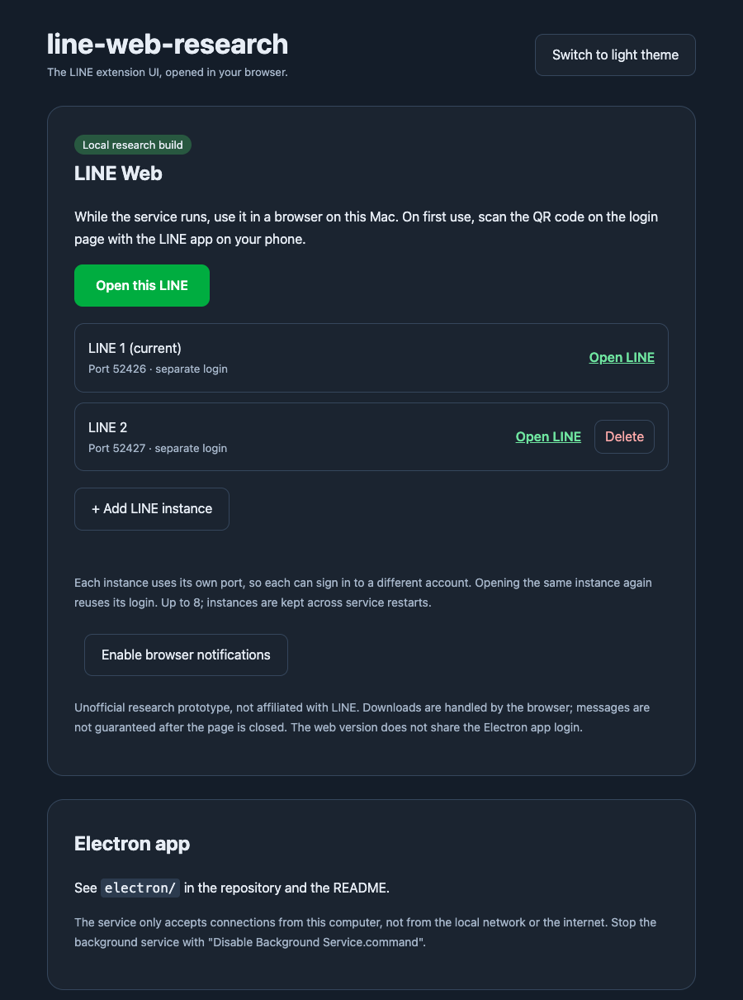
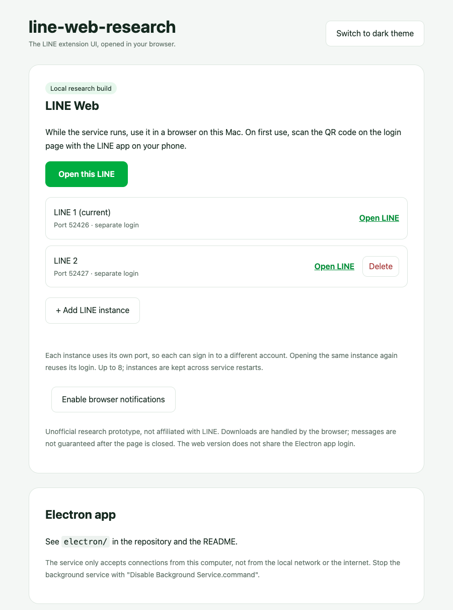
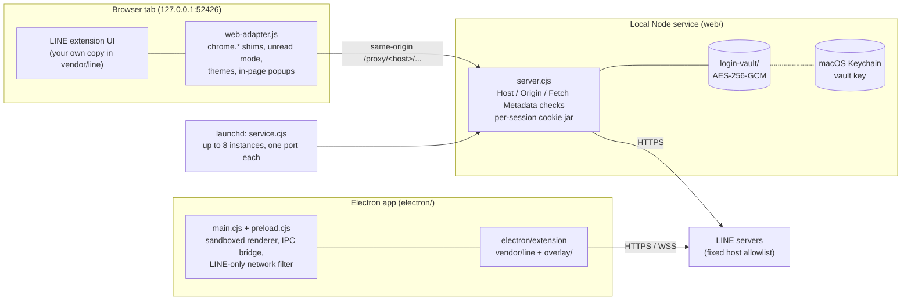

<h1 align="center">line-web-research</h1>

<p align="center">
  <b>A research prototype that runs the LINE Chrome extension as a local web page or an Electron app.</b><br>
  It is unofficial and targets macOS; you bring your own copy of the extension.
</p>

<p align="center">
  English · <a href="README.zh-TW.md">繁體中文</a>
</p>

> **For research only. Unofficial project.**
>
> This is a personal research project that explores the compatibility layer needed to run a browser extension as an ordinary web page and inside Electron. It is not affiliated with, authorized or endorsed by LINE, LY Corporation or their affiliates. "LINE" and its logo belong to their respective owners.
>
> - This repository contains **no** LINE code, icons or assets, apart from a short pattern used to locate the function it adapts (see [How compatibility works](#how-compatibility-works)). It holds only our own compatibility layer and local service. To run it you must obtain the official LINE Chrome extension yourself.
> - Using an unofficial client may violate LINE's terms of service and may get your account restricted. Whether to use it, and any consequences, are your own responsibility.
> - Use it only with your own account, for personal research and learning. Do not use it commercially, for bulk or automated messaging, advertising, harassment or any other abuse.
> - "Unread mode" is an experiment for studying the extension's behavior. Respect the people you talk to; do not use it to mislead or monitor anyone.
> - The software is provided as is, without warranty of any kind (see [LICENSE](LICENSE)).

## What it is

line-web-research is the compatibility layer and local service that let your own copy of the LINE Chrome extension run in a browser tab or in Electron. The repository has these parts:

- `web/`: a local Node service (listening only on `127.0.0.1`), a portal page and a browser compatibility layer. It stands in for the Electron / Chrome extension environment and forwards LINE's API requests only to a fixed allowlist of LINE hosts.
- `electron/`: the Electron main process, preload and download handling, plus three compatibility files in `overlay/` that are added to the extension (`electron-compat.js`, `unread-mode.js`, `theme-mode.js`).
- `scripts/prepare-electron-extension.cjs`: builds `electron/extension/` from your own copy of the LINE extension.
- `scripts/install-launchagent.sh`: installs the web version as a macOS background service.

## Features

- Multiple instances: up to 8 separate accounts, each on a fixed port.
- Unread mode, dark and light themes, and in-page popups.
- Attachment upload and download.
- Encrypted login persistence.

The UI text this project adds (portal, buttons, dialogs) is in English; LINE's own screens follow the language of the LINE extension.

## What it looks like

The portal page that lists instances (shown with two sample instances; LINE's own screens are not included in this repository):

<p>
  
  
</p>

## Requirements

- macOS (the background service uses launchd and the Keychain; Electron packaging currently targets Apple Silicon only)
- Node.js 22 or later
- LINE Chrome extension **3.7.2** (the version is checked; other versions are untested, and some compatibility steps refuse to run on them)

## Getting the LINE extension

The LINE files are not in this repository. Prepare them yourself:

1. In Google Chrome, install [LINE](https://chromewebstore.google.com/detail/line/ophjlpahpchlmihnnnihgmmeilfjmjjc) from the Chrome Web Store.
2. Find the installed folder: `Extensions/ophjlpahpchlmihnnnihgmmeilfjmjjc/3.7.2_0/` under your Chrome profile (`chrome://version` shows the profile path).
3. Copy the contents of that folder to `vendor/line/` in this repository, so that `vendor/line/manifest.json` exists.

You can also point the environment variable `LINE_EXTENSION_DIR` at another location. `vendor/` and `electron/extension/` are in `.gitignore` and are never committed. Do not upload or redistribute these files.

Copy only the extension's own files. Do not copy anything else from your Chrome profile (cookies, login data and so on).

## Web version

Run in the foreground (single instance; the login lives only in memory, so you sign in again after quitting):

```sh
npm start
```

Or double-click `Start Web.command`, which also opens the browser.

Run in the background (multiple instances and encrypted login persistence):

```sh
scripts/install-launchagent.sh
```

This creates `~/Library/LaunchAgents/local.line-web-research.plist`, tied to the current `node` path and repository location; run it again after moving the repository or changing Node versions. Then open the page with `Open XXNE Web.command`, and stop the service and disable start at login with `Disable Background Service.command`.

- The main entry is always `http://127.0.0.1:52426/`; instance N uses port `52426 + N - 1`.
- Runtime data lives in `~/Library/Application Support/line-web-research/`: `instances.json` (instance numbers), `service.log` (startup status only), `service.sock` (control socket, mode 0600) and `login-vault/`.

### Login persistence and its risks

The background service encrypts each session's LINE cookies with AES-256-GCM and stores them in `login-vault/`. The 256-bit key is kept only in the macOS Keychain (`local.line-web-research.login-vault.v1`). Ciphertext is bound to the origin (including port) and session; the folder is 0700 and files are 0600. Logging out removes the matching data; cookies without an expiry time are dropped after 90 days without use.

This is not a chat backup. A program that controls your current macOS account, or can read that browser profile, may still be able to use your login. Do not share your browser profile, `login-vault/` or the Keychain key.

### How compatibility works

- The service presents the official extension's identity to LINE: every request it forwards carries the extension's origin (`chrome-extension://ophjlpahpchlmihnnnihgmmeilfjmjjc`) as its `Origin` header, and `sandbox-env.js` gives the LTSM sandbox frame that same origin as `window.origin`. LINE's servers therefore see the requests as coming from the official extension.
- The service changes LINE's files as it serves them, in these places only: it adds `web-adapter.js` to `index.html` and `popup.html` and removes their `main.js` / `popup.js` script tags (the adapter loads them after its shims are in place); it adds `sandbox-env.js` to `ltsmSandbox.html`; and in the LTSM 3.7.2 sandbox script it rewrites one host import from `window.location.origin` to `window.origin`. That rewrite looks for a short fragment of LINE's code and refuses on any mismatch. The files on disk, the WASM and the encryption algorithms are not modified.
- `web-adapter.js` fills in the Electron / Chrome extension APIs with browser APIs and implements unread mode, themes and in-page popups.
- Security boundaries: listening only on `127.0.0.1`, an allowlist of proxy destinations, Host / Origin / Fetch Metadata checks, no following of upstream redirects, and no logging of headers, cookies, request bodies or query strings.

### Unread mode

Unread mode is off by default. Turn it on with the crossed-out eye button next to LINE's sound setting; the choice is remembered. When it is on, opening a chat does not send a read receipt: the page keeps window focus from LINE and answers `TalkService/sendChatChecked` inside the page, so the request never reaches LINE. The local chat list may still show the chat as read. After you turn unread mode off, the open chat is marked read as usual the next time the window gets focus.

## Electron version

```sh
cd electron
npm ci
npm run prepare-extension   # builds electron/extension from vendor/line
npm start
npm run package             # produces dist/XXNE-darwin-arm64/XXNE.app (ad-hoc signed)
```

`prepare-extension` copies the LINE extension, removes the background worker and store update settings, reduces permissions to `storage`, limits hosts to LINE domains, and makes `index.html` / `popup.html` load the three files in `overlay/`. It also sets the manifest `key` of the Chrome Web Store item, so the app keeps the official extension's ID and origin and LINE's servers see it as the official extension. LINE's chat code, authentication and encryption are unchanged.

The Electron version stores its data in `~/Library/Application Support/LINE Electron Prototype`, separate from LINE's official desktop app and Chrome. The app is named XXNE so it is not mistaken for LINE's official app. It has no Developer ID signature, notarization or automatic updates.

## Architecture



The web version replaces the Chrome extension environment with a local service: the page talks only to its own origin, and the service forwards allowed requests to LINE with the session's cookies. The Electron version loads the prepared extension directly and talks to LINE itself.

## Limits

- Messages and notifications are not guaranteed after the page is closed.
- Screenshots and screen sharing are not ported; upstream redirects are not supported.
- A web page cannot tell when a download finishes; attachments are left to the browser's download list.
- Local use only; no LAN or public deployment.
- A LINE extension update may break the compatibility layer and needs re-verification.

## Security

line-web-research runs only on your own Mac, and the background service keeps your LINE login in an encrypted vault on disk. See [SECURITY.md](SECURITY.md) for how it is meant to run, what to keep in mind and how to report a vulnerability.

## Contributing

Issues and pull requests are welcome. See [CONTRIBUTING.md](CONTRIBUTING.md).

## License

The code in this repository is under the [MIT License](LICENSE). It neither includes nor licenses any LINE code, trademarks or assets, apart from the short pattern `web/server.cjs` uses to locate the function it adapts.

line-web-research is an independent project. It is not made by, affiliated with or endorsed by LY Corporation. LINE is a trademark of LY Corporation.

Made by [V-AX](https://v-ax.com).
