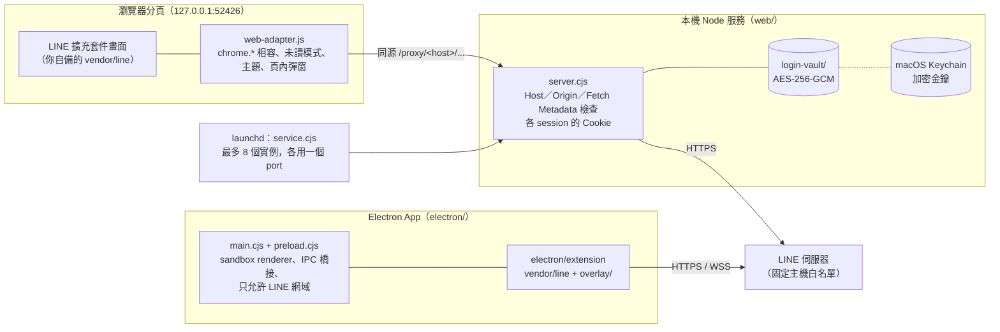
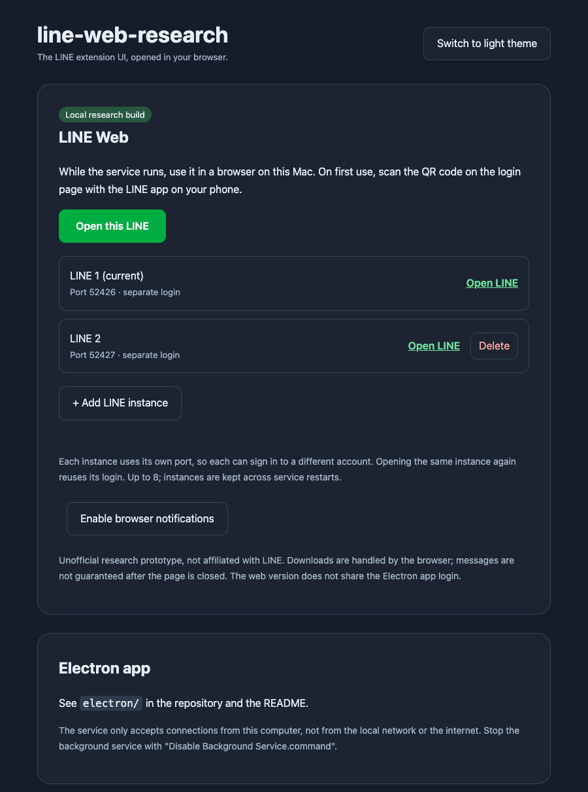
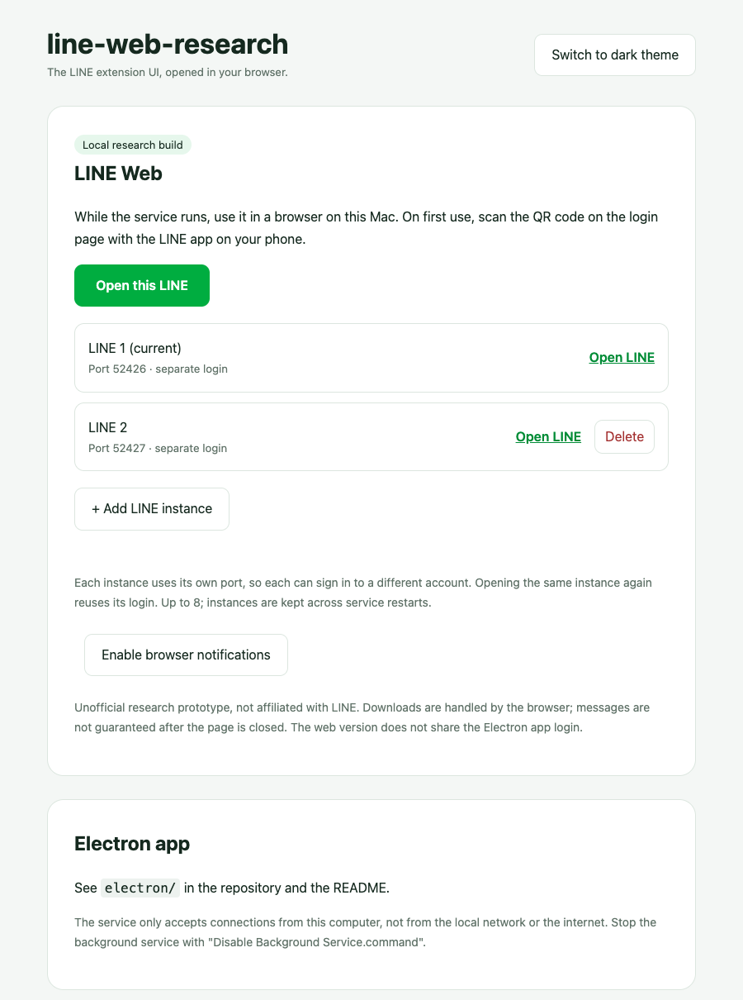

# line-web-research

[English](README.md) | 繁體中文

> **研究用途｜非官方專案**
>
> 這是個人研究專案，用來探索「把瀏覽器擴充套件搬到一般網頁和 Electron 執行」時，相容層要怎麼做。本專案與 LINE、LY Corporation 及其關係企業沒有任何關係，也沒有得到他們的授權或認可。「LINE」名稱與標誌屬於其權利人。
>
> - 本 repo **不含** LINE 的任何程式碼、圖示或資源，只有我們自己寫的相容層、本機服務與測試。要執行的人必須自己取得 LINE 官方 Chrome 擴充套件。
> - 使用非官方客戶端可能違反 LINE 服務條款，帳號可能因此受限。是否使用、後果如何，由使用者自行判斷與承擔。
> - 請只用在自己的帳號、個人研究與學習。不要用於商業用途、大量或自動傳訊、廣告、騷擾，或用來規避任何安全機制。
> - 「未讀模式」是研究擴充套件行為的實驗功能，請尊重對方，不要用來誤導或監視別人。
> - 本軟體依現狀提供，不附帶任何保證（見 [LICENSE](LICENSE)）。

## 內容

- `web/`：本機 Node 服務（只監聽 `127.0.0.1`）、入口頁、瀏覽器相容層與測試。代替 Electron／Chrome 擴充套件環境，把 LINE 的 API 請求轉給固定白名單內的 LINE 主機。
- `electron/`：Electron 版的 main／preload／下載處理，以及 `overlay/` 裡要加進擴充套件的三個相容檔（`electron-compat.js`、`unread-mode.js`、`theme-mode.js`）。
- `scripts/prepare-electron-extension.cjs`：從你自備的 LINE 擴充套件做出 `electron/extension/`。
- `scripts/install-launchagent.sh`：把網頁版裝成 macOS 背景服務。

功能：多開（最多 8 個獨立帳號，各用固定 port）、未讀模式、深淺色主題、頁內彈窗、附件上傳下載，以及加密保存登入狀態。我們加的介面文字（入口頁、按鈕、對話框）是英文；LINE 本身的畫面語言跟著 LINE 擴充套件。

## 架構



網頁版用本機服務取代 Chrome 擴充套件環境：頁面只跟自己的 origin 溝通，由服務帶著該 session 的 Cookie，把允許的請求轉給 LINE。Electron 版直接載入處理過的擴充套件，自己連 LINE。

## 截圖

列出實例的入口頁（以兩個示範實例拍攝；本 repo 不收錄 LINE 本身的畫面）：

<p>
  
  
</p>

## 需求

- macOS（背景服務用 launchd 和 Keychain；Electron 打包目前只做 Apple Silicon）
- Node.js 22 以上
- LINE Chrome 擴充套件 **3.7.2**（程式會檢查版本；其他版本未驗證，部分相容處理會直接拒絕執行）

## 取得 LINE 擴充套件

LINE 檔案不放在本 repo，請自己準備：

1. 在 Google Chrome 從 Chrome 線上應用程式商店安裝 [LINE](https://chromewebstore.google.com/detail/line/ophjlpahpchlmihnnnihgmmeilfjmjjc)。
2. 找到安裝後的資料夾：Chrome 設定檔下的 `Extensions/ophjlpahpchlmihnnnihgmmeilfjmjjc/3.7.2_0/`（可在 `chrome://version` 看設定檔路徑）。
3. 把整個資料夾的內容複製到本 repo 的 `vendor/line/`，讓 `vendor/line/manifest.json` 存在。

也可以設定環境變數 `LINE_EXTENSION_DIR` 指向其他位置。`vendor/` 和 `electron/extension/` 已列在 `.gitignore`，不會被 commit。請不要把這些檔案上傳或散布。

只需要擴充套件本身的檔案，不要複製 Chrome 設定檔裡的其他資料（Cookie、登入資料等）。

## 網頁版

前景執行（單一實例，登入只存在記憶體，關掉就要重登）：

```sh
npm start
```

或雙擊 `Start Web.command`，會開啟瀏覽器。

背景常駐（多開與加密保存登入）：

```sh
scripts/install-launchagent.sh
```

這會建立 `~/Library/LaunchAgents/local.line-web-research.plist`，綁定目前的 `node` 路徑與 repo 位置；移動 repo 或換 Node 版本後要重新執行。之後用 `Open LINE Web.command` 開頁面，`Disable Background Service.command` 停止並取消自動啟動。

- 主入口固定在 `http://127.0.0.1:52426/`，第 N 個實例用 `52426 + N - 1`。
- 執行期資料在 `~/Library/Application Support/line-web-research/`：`instances.json`（實例編號）、`service.log`（只記啟動狀態）、`service.sock`（權限 0600 的控制 socket），以及 `login-vault/`。

### 登入保存與風險

背景服務會把各 session 的 LINE Cookie 用 AES-256-GCM 加密後存在 `login-vault/`，256-bit 金鑰只存在 macOS Keychain（`local.line-web-research.login-vault.v1`）。密文綁定 origin（含 port）與 session，資料夾 0700、檔案 0600。登出會清掉對應資料；沒有到期時間的 Cookie 在最後使用 90 天後失效。

這不是聊天備份。能控制你目前 macOS 帳號或讀得到該瀏覽器設定檔的程式，仍可能使用你的登入。不要分享瀏覽器設定檔、`login-vault/` 或 Keychain 金鑰。

### 相容做法

- 只有一個地方改到 LINE 的回應內容：LTSM 3.7.2 的 WASM host import 原本讀 `window.location.origin`，服務在回應時改成讀 `sandbox-env.js` 提供的擴充套件 origin。程式會先檢查版本字串，不符就拒絕。原始檔案、WASM 與加解密演算法都沒有改。
- `web-adapter.js` 以瀏覽器 API 補上 Electron／Chrome 擴充套件 API，並實作未讀模式、主題與頁內彈窗。
- 安全邊界：只監聽 `127.0.0.1`、代理目的地白名單、檢查 Host／Origin／Fetch Metadata、不跟隨上游重新導向、不記錄 headers、Cookie、請求內容或 query string。

### 未讀模式

開啟時（預設開啟），聊天室看了不會送出已讀：頁面不把視窗焦點交給 LINE，並在頁面內直接回應 `TalkService/sendChatChecked`，請求不會送到 LINE。本機清單可能仍顯示已讀；關閉未讀模式後，下次切回視窗時開著的聊天室會照常變成已讀。

## Electron 版

```sh
cd electron
npm ci
npm run prepare-extension   # 從 vendor/line 做出 electron/extension
npm start
npm run package             # 產生 dist/LINE-darwin-arm64/LINE.app（ad-hoc 簽章）
```

`prepare-extension` 會複製 LINE 擴充套件，移除背景 worker 與商店更新設定、權限縮小到 `storage`、主機限 LINE 網域，並在 `index.html`／`popup.html` 載入 `overlay/` 的三個檔案。LINE 的聊天程式、驗證與加密邏輯不變。

Electron 版的資料存在 `~/Library/Application Support/LINE Electron Prototype`，與官方 LINE、Chrome 分開。沒有 Developer ID 簽章、公證或自動更新；不要覆蓋官方 LINE.app。

測試（不登入、不傳訊息）：

```sh
npx electron . --smoke            # 登入畫面與原生橋接邊界
npx electron . --download-smoke   # 合成附件下載
npx electron . --unread-smoke     # 主題與未讀模式
node --test tests/download-host.test.cjs
```

## 測試

```sh
npm test
```

涵蓋來源限制、代理白名單、session／Cookie 隔離、加密保存、多開實例與 LTSM 相容轉換。沒有 `vendor/line` 時，LTSM 那一項會略過。自動測試不代表帳號功能已驗證。

## 已知限制

- 不保證關閉頁面後還會收訊或通知。
- 截圖、螢幕分享未移植；不支援上游重新導向。
- 一般網頁無法得知下載是否完成，附件交給瀏覽器下載列表處理。
- 只在本機使用，不提供區網或公開部署。
- LINE 擴充套件更新後，相容層可能失效，需要重新驗證。

## 授權

本 repo 自己的程式碼採用 [MIT License](LICENSE)。不包含、也不授權任何 LINE 的程式碼、商標或資源。
